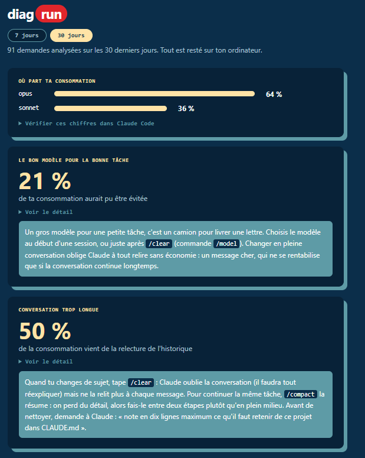

# diagrun

**Où partent tes tokens Claude Code ? Un diagnostic en une commande, 100 % local.**

> **In English:** diagrun reads your local Claude Code sessions and opens a plain-language report in your browser: which tasks ran on a model bigger than needed, how much your long conversations cost, and what you would have saved by following its advice. Nothing is sent anywhere. Requires Node 18+. The report and this README are in French for now; contributions in other languages are welcome.



## Pourquoi

Beaucoup de gens disent « je crame mes tokens très vite, je ne comprends pas ». Le plus souvent, deux causes reviennent : un gros modèle (Opus) utilisé pour des tâches qu'un petit (Haiku) aurait faites, et des conversations qui s'allongent sans jamais être vidées, parce que Claude relit tout l'historique à chaque message.

diagrun lit tes sessions passées et te montre, en quelques cartes lisibles :

- **Le bon modèle pour la bonne tâche** : quelles demandes simples ont tourné sur un modèle trop gros.
- **Conversation trop longue** : la part de ta consommation due à la relecture de l'historique.
- **Actions inutiles** : fichiers relus plusieurs fois, commandes répétées, résultats énormes.
- **Si tu avais suivi ces conseils** : une estimation de ce que tu aurais économisé.

## Ce dont tu as besoin : Node

diagrun se lance avec **Node 18 ou plus récent**.

Attention : **Claude Code n'installe pas Node**. Si tu as installé Claude Code avec l'installeur natif, tu n'as peut-être pas Node sur ta machine. Pour vérifier, ouvre un terminal et tape :

```bash
node --version
```

- Si un numéro s'affiche (par exemple `v22.1.0`) et qu'il commence par 18 ou plus : tu es prêt.
- Si tu obtiens une erreur du type « commande introuvable » : installe Node depuis [nodejs.org](https://nodejs.org) (choisis la version « LTS »), puis rouvre ton terminal et refais le test.

## Lancer diagrun

### Méthode 1 : depuis Claude Code (la plus simple)

Dans une session Claude Code, tape à l'invite, **avec le point d'exclamation devant** :

```
! npx diagrun@latest
```

Le `!` dit à Claude Code d'exécuter la commande directement, sans passer par Claude. Ton navigateur s'ouvre sur le rapport.

Le `!` ne fonctionne **que dans Claude Code**. Dans un terminal classique (PowerShell, Terminal), ne le tape pas : utilise la méthode 2.

### Méthode 2 : depuis un terminal

Ouvre un terminal :
- **Windows** : touche Windows, tape `powershell`, Entrée.
- **Mac** : Cmd + Espace, tape `terminal`, Entrée.

Puis tape la commande, **sans point d'exclamation** :

```bash
npx diagrun@latest
```

Évite de la lancer depuis un dossier nommé `diagrun`, npx s'y perdrait.

### Ce qui se passe ensuite

La première fois, npx te demande de confirmer l'installation temporaire : réponds `y`. Ensuite, ton navigateur s'ouvre sur le rapport. Il est aussi enregistré dans `~/.diagrun/rapport.html` (sous Windows : `C:\Users\<toi>\.diagrun\rapport.html`).

Le rapport s'ouvre sur les **7 derniers jours**, avec deux boutons en haut, **7 jours** et **30 jours**, pour passer de l'un à l'autre sans relancer.

Pour une seule période de ton choix (par exemple 14 jours), ajoute l'option `--days` : le rapport n'aura alors pas de boutons.

```bash
npx diagrun@latest --days 14
```

**Limite à connaître :** Claude Code supprime lui-même les anciennes sessions, par défaut au bout de 30 jours. Même avec `--days 90`, diagrun ne voit donc que ce qui reste sur ton ordinateur.

Le `@latest` est important : il force npx à récupérer la dernière version au lieu de réutiliser une copie gardée en cache.

**Depuis GitHub** (si le paquet n'est pas sur npm, il faut aussi avoir **git**) :

```bash
npx github:Francoisnollet/diagrun
```

### Options

| Option | Rôle |
|---|---|
| `--days N` | Une seule période de N jours, sans boutons (par défaut : 7 et 30 jours, avec boutons) |
| `--no-open` | Ne pas ouvrir le navigateur automatiquement |
| `--out fichier.html` | Écrire le rapport à un autre endroit |
| `--version` | Afficher le numéro de version |

La variable `DIAGRUN_HOME` change le dossier où le rapport est enregistré.

## Rester à jour

diagrun **ne se connecte jamais à internet**, donc il ne vérifie pas tout seul s'il existe une nouvelle version. Deux choses à faire :

1. **Relance toujours avec `npx diagrun@latest`** (précédé de `! ` dans Claude Code) : tu as alors la dernière version à chaque fois, sans rien installer.
2. **Surveille le dépôt pour être prévenu** : en haut de cette page GitHub, clique sur **Watch**, puis **Custom**, coche **Releases** et valide. GitHub t'enverra un message à chaque nouvelle version, sans te spammer.

Pour savoir quelle version tu utilises, regarde le bas du rapport (« diagrun v… ») ou tape `npx diagrun@latest --version`.

## Confidentialité

- diagrun lit uniquement les fichiers de sessions de Claude Code qui sont **déjà sur ton ordinateur** (dans `~/.claude/projects`).
- Il écrit un seul fichier : le rapport HTML.
- **Aucune donnée n'est envoyée nulle part.** Il n'y a aucun appel réseau.
- Attention : le rapport peut afficher le début de certaines de tes demandes (dans les exemples). **Relis-le avant d'en partager une capture.**

## À savoir sur les chiffres

- Les montants sont des **estimations** basées sur les tarifs publics, que tu peux modifier en tête de `cli.js` (variable `PRICES`). Sur un abonnement, lis-les comme des parts de consommation plutôt que comme des euros.
- Le classement des tâches (simple, moyenne, complexe) repose sur des règles simples, pas sur de l'intelligence artificielle. C'est une indication, pas un verdict.
- La carte « Si tu avais suivi ces conseils » est une projection prudente. Haiku peut faire un peu moins bien qu'Opus, et repartir de zéro oblige à réexpliquer.
- Claude Code n'enregistre pas toujours le décompte final des tokens de sortie (notamment la réflexion), d'après des signalements d'utilisateurs que nous n'avons pas pu confirmer. Dans le rapport, la part de la sortie peut donc être sous-estimée.
- Le niveau d'effort (`/effort`) n'est pas noté dans les sessions : diagrun ne peut pas le mesurer, il peut seulement te le rappeler comme levier.
- Pour vérifier ces chiffres dans Claude Code même, tape `/usage` (tokens par modèle) et `/context` (ce qui remplit ta conversation).

## diagrun et `/insights`

La commande `/insights` de Claude Code analyse ta façon de travailler (avec l'IA, en quelques minutes). diagrun se concentre sur ta consommation : quel modèle pour quelle tâche, quelles conversations coûtent trop cher, et ce que tu aurais économisé. En local, sans IA, en quelques secondes. Les deux se complètent.

## Signaler un problème ou une idée

Ouvre une « issue » sur ce dépôt. Si une de tes demandes est mal classée, décris simplement le type de tâche (sans contenu privé) : ça aide à améliorer les règles.

## Un coup de pouce

Si diagrun t'a servi, une étoile sur GitHub (bouton « Star », en haut de cette page) aide à le faire connaître.

## Licence

MIT. Fait par François Nollet, construit avec Claude (Anthropic) via Claude Code.
